<!--
  NOIR-TERMINAL // GitHub profile README
  Repo name must equal your GitHub username (Noir-Terminal/Noir-Terminal).

  Find & replace before publishing:
    Noir-Terminal        -> your GitHub username   (stats section + links)
    PROJECT_REPO_1..3    -> repo names of your featured projects
    YOUR_INSTAGRAM, YOUR_YOUTUBE, YOUR_X, YOUR_EMAIL -> social handles / address
-->

  

  

  

  

  

  

  

  
   
  
   
  <a href="https://github.com/Noir-Terminal/Wifi-Card-Generator"></a>
   
  <a href="https://github.com/Noir-Terminal/NeoMorph-Calc"></a>

  
   
  
   
  
   
  

  
   
  
  <a href="https://youtube.com/@YOUR_YOUTUBE"></a>
  <a href="https://x.com/YOUR_X"></a>
  <a href="https://github.com/Noir-Terminal"></a>
  <a href="mailto:YOUR_EMAIL"></a>

  

